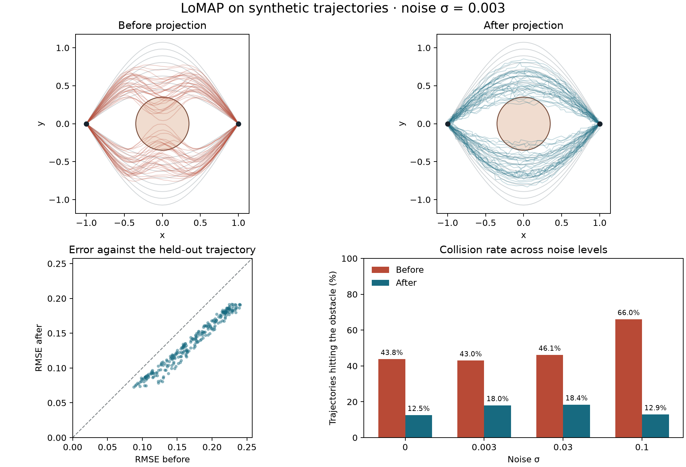

# LoMAP 阶段 A · 二维合成轨迹实验

在固定起终点、固定待修正轨迹的条件下，观察一次 LoMAP 投影对碰撞和轨迹误差的影响。实验在 CPU 上运行，使用 NumPy 做精确 cosine k-NN 和 SVD，使用 Matplotlib 出图。依据为论文 Algorithm 2，投影形式采用作者实现中的有中心 PCA。 [ICML 2025 论文](https://proceedings.mlr.press/v267/lee25f.html) · [官方投影实现](https://github.com/leekwoon/lomap/blob/8ccb052481484352affaada26a0895102aef3e52/cleandiffuser_ex/local_manifold.py#L17-L95)

## 运行

需要 `uv` 和 Python 3.13。`.python-version` 固定 Python 系列，`uv.lock` 固定依赖。下列命令把虚拟环境、缓存和实验产物留在项目里。

```bash
cd phase_a
uv run --locked python -m unittest -v
uv run --locked python experiment.py
```

默认 seed 为 `20261120`。要用其他 seed 并保留本次结果，可指定新的输出目录。

```bash
uv run --locked python experiment.py --seed 20261121 --output results/seed-20261121
```

## 数据处理

1. **轨迹库和评估参考。** 在 `u ∈ [0, 1]` 上均匀取 41 个点，轨迹为 `x = 2u − 1, y = a sin(πu)`。库中有 128 条轨迹，上下各 64 条，`|a|` 在 `[0.45, 1.15]` 上均匀取值。评估参考轨迹有 256 条，上下各半，从 `[0.48, 0.98]` 连续抽取 `|a|`，仅用于构造输入及衡量误差。起点 `(-1, 0)`、终点 `(1, 0)` 固定。半径 `0.35` 的圆障碍以原点为中心。库和评估参考的所有线段都避开障碍。
2. **构造待修正样本。** 向 `x` 添加 `h sin³(πu)`，`h ~ U[-0.16, 0.16]`。向 `y` 添加指向障碍的局部扰动 `−sign(a) v sin⁸(πu)`，`v ~ U[0.20, 0.52]`。得到 `x_drift` 后在内点构造 `x_t = c x_drift + σ ε`，其中 `c = √(1 − σ²)`，`ε` 为标准高斯噪声。四个 `σ` 共用基础轨迹、偏移和标准化噪声样本。对照组直接保留这条输入轨迹。
3. **检索和投影。** 用已知的 `ε` 代替神经网络噪声预测，得到 clean surrogate `(x_t − σ ε) / c`。其中还保留人工偏移。把整条 surrogate 展平，在 clean bank 中找 cosine similarity 最高的 10 个邻居。逐个用独立高斯噪声把邻居推进到同一噪声水平。对内点展平、中心化并做 PCA，取累计解释方差达到 `0.99` 的最小 rank。按 `m + U Uᵀ (x_t − m)` 投影，再保留原起终点。 [官方加噪与取邻居实现](https://github.com/leekwoon/lomap/blob/8ccb052481484352affaada26a0895102aef3e52/cleandiffuser_ex/diffusion/diffusionsde_ex.py#L22-L71)
4. **评估。** 两组的内点都除以相同的 `c` 映回同一坐标尺度，保留剩余噪声。把所有相邻 waypoint 连成线段，到原点的最短距离若 `≤ 0.35` 即计一次碰撞。轨迹 RMSE 是各 waypoint 到该试次 clean 参考的平方欧氏距离取平均后开方。每条轨迹与自身投影前的结果配对。

## 结果

| 噪声 σ | 碰撞数，前 → 后 | 平均轨迹 RMSE，前 → 后 | PCA rank 中位数 |
|---:|---:|---:|---:|
| 0 | 112 → 32 | 0.1703 → 0.1338 | 1 |
| **0.003** | **110 → 46** | **0.1704 → 0.1361** | **5** |
| 0.03 | 118 → 47 | 0.1755 → 0.1350 | 9 |
| 0.10 | 169 → 33 | 0.2209 → 0.1384 | 9 |

主配置碰撞率从 `43.0%` 降至 `18.0%`，少了 25 个百分点。剩余 46 条碰撞说明局部线性投影没有提供避障保证。较大的 `σ` 同时改变了输入和邻域点，因此表里的绝对碰撞数只用于各行内部的配对比较。实验借助已知噪声构造检索 surrogate，只测单步投影，不训练 denoiser，也没有 D4RL、MuJoCo 和闭环 rollout。图中每组展示相同的 64 条轨迹，汇总统计使用全量 256 条。



## 产物与核验

- [experiment.py](experiment.py) 包含数据生成、预处理、配对评估和出图，[lomap.py](lomap.py) 包含单步投影。
- [summary.json](results/summary.json) 保存参数和汇总，[trials.csv](results/trials.csv) 保存 4 × 256 条观测，`trial_id` 从 0 开始，`clearance_*` 是到原点的最短距离。
- [trajectories.npz](results/trajectories.npz) 可用 `numpy.load` 读取。`bank` 是 `(128, 41, 2)`，`clean`、`drifted`、`query_noise` 是 `(256, 41, 2)`，`neighbor_noise` 是 `(256, 10, 41, 2)`，其邻居轴对应每次检索的排序。`before`、`after` 是 `(4, 256, 41, 2)`，按 `sigmas` 排列，保存评估坐标。`neighbor_ids` 是 `(4, 256, 10)`，索引 `bank`。`rank` 和 `explained_variance` 是 `(4, 256)`。
- 在 CPython 3.13.16 环境中，5 个测试通过。相同 seed 重跑约 **0.83 秒**，含出图和保存。四份结果逐字节一致，1,024 条 CSV 记录与汇总碰撞数一致，起终点和 PCA 阈值均核验通过。
